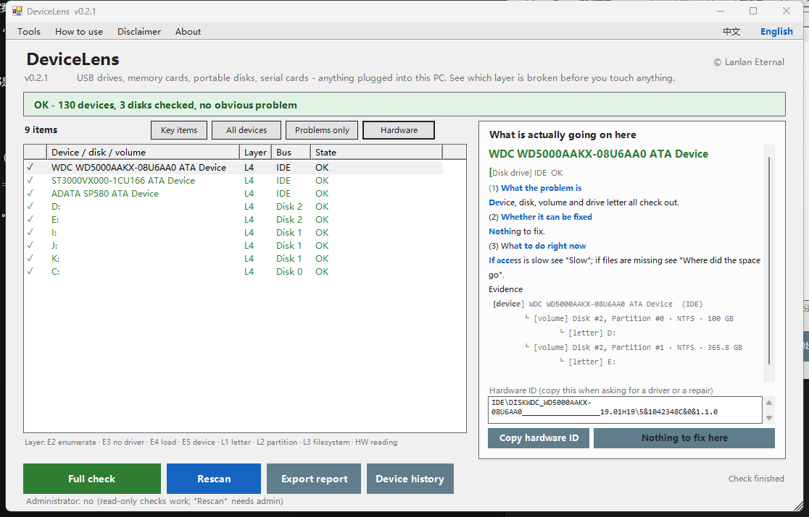
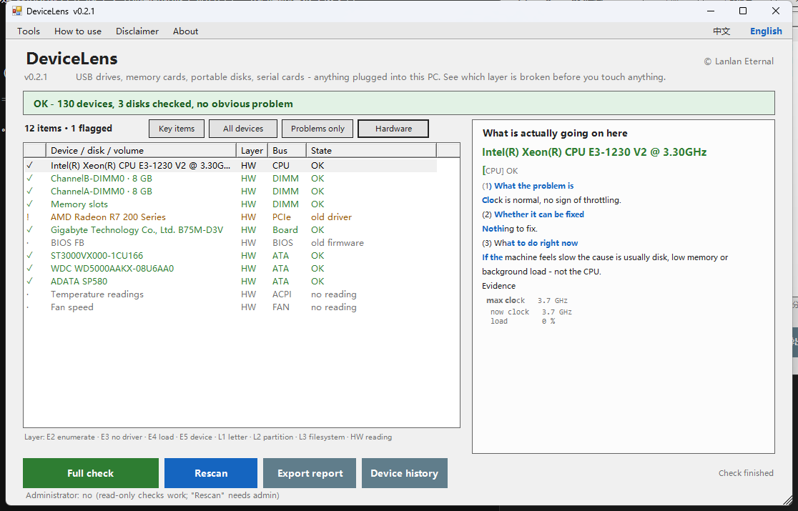

# DeviceLens

> USB drives, memory cards, portable disks, serial cards — anything plugged into this PC.
> **See which layer is broken before you touch anything.**

Author: **© Lanlan Eternal**　·　Version: **v0.2.2**　·　Windows 7 / 10 / 11, 32-bit and 64-bit
Portable, no installer · no network · scanning is **read-only**; two repairs, both reversible





---

## The problem it solves

When a device stops working, the cause is always on one link of a chain:

```
physical link -> enumeration -> driver match -> driver load -> function
                                      |
                    disk -> partition -> volume -> drive letter
```

**The first broken link decides what you should do — and what you should not do.**

Most of the time "my disk is dead" is not a dead disk:

| What you think | What it usually is | Outcome |
|---|---|---|
| The disk is broken | The partition is fine, it just has no drive letter | One command away from working |
| The drive is dead | Windows identified the hardware but has no matching driver | Install the right driver |
| The flash drive burned out | The device is disabled | One second to re-enable |
| The motherboard is gone | Enumeration stalled; Windows never rescanned | Press "scan for hardware changes" |

Those cases are fixable in software with zero risk.
The genuinely broken ones — heads, worn-out NAND, controller firmware loss — will not
be fixed by reinstalling drivers. That is when a **different decision** is needed,
not another attempt.

**This tool covers the stage before you send the device for repair or data recovery.**

---

## The core idea: judge by layer, not by feature list

Every conclusion carries a layer:

| Layer | Meaning | What software can do |
|---|---|---|
| **E2** | Enumeration — Windows does not see the device at all | Rescan; usually enough |
| **E3** | Matching — device seen, no driver matches (code 28) | Install the driver; hardware is fine |
| **E4** | Loading — driver installed but will not start (10 / 12 / 31 / 52) | Try another driver version |
| **E5** | Function — driver healthy, so suspect the device itself | Software is done; check cable, port, power |
| **L1** | Volume — partition fine, drive letter missing | Assign a letter, touch no data |
| **L2** | Partition table — no partitions, Windows asks to initialise | **Do not initialise**; back up first |
| **L3** | Filesystem — partition exists, unreadable (RAW) | Back up, then rebuild; never format for you |
| **L4** | Healthy | — |
| **HW** | Hardware reading — CPU / memory / GPU / board / thermal | Read-only; gives a conclusion and advice |

Why this matters: **it turns "can it be fixed?" into a conclusion you can derive from
evidence**, instead of a guess.

E2 or L1 — fixable with zero risk. E3 or E4 — get the driver version right.
E5 — stop, and look at the hardware.

---

## Three answers per row, nothing more

Click any row. The right panel answers exactly three questions:

1. **What the problem is** — one plain sentence plus evidence
2. **Whether it can be fixed** — yes / only mitigated / no, and why
3. **What to do right now** — back up, stop, or replace

No glossary to translate, and no single "Fix" button to gamble on.
Only the two genuinely repairable cases turn the button green, and the previous
state is written down before anything changes.

---

## It does repair — exactly two things

Select any row and the button at the bottom right changes with it:

| Button | Meaning |
|---|---|
| 🟢 **Fix this (reversible)** | Software can fix this row — press it |
| ⚪ Nothing to fix here | It was healthy all along |
| ⚪ Software cannot fix this | Something else is needed; the panel says who |

Only two cases turn green:

1. **A data partition that lost its drive letter (L1)** — assign a free letter, no data touched
2. **A device that got disabled** — same as "Enable device" in Device Manager

What happens when you press it:

- A confirmation dialog states what will be done and to what; nothing runs until you say yes
- Without admin rights it first offers to restart elevated
- **Before touching anything** the previous state is written to an undo log
- Afterwards it rescans automatically, so you see whether it worked

**Undo is always available**: Tools → Undo the last repair restores the previous state;
every action is listed under "Open the repair log" (`%APPDATA%\DeviceLens\fix\log.txt`).

A grey button is not laziness — those are the decisions software should not make for you:
format, rebuild a partition table, recover data, flash firmware, install a driver from a
download site.

---

## Features (v0.2.2)

- **Read-only check** linking four layers: device / disk / volume / drive letter
- **Four views**: key items, all devices, problems only, **hardware**
- **Hardware readings**: CPU clock / cores / load, memory modules and slots, GPU driver
  version and date, board and BIOS, disk health, thermal zones, fan speed — with real
  findings: a throttled CPU, memory below its rated speed (XMP off), an old GPU driver,
  an old BIOS
- **Partition identity**: EFI system, MSR reserved and extended-container partitions
  **are not supposed to have a drive letter** and are no longer reported as missing one
- **22 device error codes translated** into plain language (code 10 is not "broken", code 28 is not "driver lost", code 52 usually means the clock is wrong)
- **Drive letter map A–Z** — answers "why can't I use D:" without opening Disk Management
- **Device history** — devices used before and not plugged in now (idea borrowed from USBDeview)
- **Rescan (L0)** — identical to "Scan for hardware changes", zero writes
- **Export a report** — five sections, ready to send to someone who can help
- **Bilingual** — 中文 / English in the top-right corner; the choice is remembered
- **Portable** — unzip and run; no service, no system changes, no telemetry

### Shortcuts

`F5` full check　·　`F9` rescan

---

## Quick start

**Just want one file to double-click:**

1. Download **`DeviceLens-v0.2.2.exe`** from [Releases](../../releases/latest)
2. Double-click it. No unzip, no installer, no network

**Want the source next to it, or want to audit it first:**

1. Download `device-lens-v0.2.2.zip`
2. **Extract the whole archive** to any folder (not inside the zip)
3. Run `设备诊断修复.exe`, or `请双击这个-设备诊断修复.bat` — same script
   either way, and `_program/` holds the full source

**Then:** plug in the misbehaving device → press the green **Full check** →
click any row.

No administrator rights needed. Only "Rescan" and the two repairs need them;
the UI asks, and can restart itself elevated in one click.

---

## How it differs from the tools you may already know

Not a replacement. It fills a spot none of them fill: a **free, plain-language,
reversible "why" step**.

| Tool | Strong at | Missing | What DeviceLens does |
|---|---|---|---|
| **USBDLM** | Industrial-grade drive letter binding by serial/port | No GUI, INI only; English; service required; paid for commercial use | GUI + bilingual + portable + open source; binding planned for v0.2 |
| **USB Device Tree Viewer** | USB topology, negotiated speed, power, descriptors | Data only, no conclusions; English | Keeps controller grouping, adds one plain sentence per node |
| **USBDeview** | Device history, timestamps, enable/disable | Flat list, no attribution; English | History on its own page, and says "this affects nothing" |
| **CrystalDiskInfo** | SMART readings, health badge | Only for devices that expose SMART; no "what to do" | Admits when SMART is unavailable instead of inventing a number |
| **ValiDrive** | 576-point fake capacity test | Four states, little explanation | Sampling plus a block map in v0.4, in Chinese |

**Unique to this tool**: layer-based judgement, the four-layer linked view, and the
three-answer conclusion format.

---

## What it will never do

- Format a disk
- Create or delete partitions / initialise a disk
- Recover data
- Flash firmware, or "repair" a flash drive with a mass-production tool
- Install a driver downloaded from a download site

The first four are the four ways to turn a small problem into a total loss.
The last one is the fastest way to turn a small problem into a blue screen.

Not because they are hard — because a one-click tool should not do them.

---

## Two facts worth stating plainly

**One: many devices expose no SMART data.**
USB flash drives, memory cards and cheap enclosures usually cannot report health —
not because the tool is weak, but because the USB bridge chip does not pass ATA
commands through. So this tool will **never invent "87% healthy"**. Every conclusion
comes from evidence it actually read: error codes, whether the partition chain is
complete, whether the filesystem is readable, whether the letter matches.

**Two: a judgement is an opinion, not a verdict.**
"The device looks faulty" is a probability. A qualified person with the device in hand
always overrides this tool.

---

## Companion tool

**[USB / Serial Port Fix](https://github.com/podcatcher962/usb-com-fix)** — fixes COM port
numbers for serial devices and re-detects USB devices Windows refuses to see.

DeviceLens covers: any device, which layer is broken. COM port numbers belong to the
companion tool; DeviceLens only points at it.

**The two are separate programs and must live in separate folders** — mixing them
overwrites files. This program refuses to start if the other tool's files are present.

---

## Version

| Version | Content |
|---|---|
| **v0.2.2** | Single-file exe: icon, version info, PerMonitorV2 DPI · "restart as administrator" now restarts the exe itself · `.config` floor relaxed from .NET 4.7 to any 4.x |
| **v0.2.1** | Repair added: assign a drive letter / re-enable a device, both reversible · undo and repair-log menus · last two Chinese leaks in the English UI fixed · stray `{n}` placeholders fixed |
| **v0.1.0** | Read-only check, four-layer view, layer judgement, 22 error codes, drive letter map, device history, rescan, report export, bilingual UI |

Planned, in this order (every step reversible):

- **v0.3** pin / guard drive letters · repair broken playlist paths · mount to a folder
- **v0.4** fake capacity sampling and block map · device identity · partition table head/tail image
- **v0.5** rescue mode (L2 rebuild partition table / L3 chkdsk / L4 zero fill) · four "cannot be fixed" verdicts
- **v0.6** access-denied repair (ACL backup then takeown/icacls) · five write-protect causes · where the space went · wrong-port detection

---

## Development

```
_src/dl-core.ps1    engine: enumerate / judge / report (shared by GUI and CLI)
_src/dl-gui.ps1     UI: WinForms, 1100x676, bilingual
build.py            packaging: .ps1 -> UTF-8 BOM + CRLF, .bat -> GBK + CRLF
```

```bash
python build.py
```

The encoding rules are not optional: PowerShell 5.1 needs **UTF-8 with BOM** for
`.ps1`, and cmd needs **GBK** for `.bat`. Miss one and the symptom is
"double-click does nothing".

UI self-test:

```powershell
.\dl-gui.ps1 -AutoScan -Shot shot.png -Lang en
```

---

## License

MIT. See [LICENSE](LICENSE).

Provided AS IS, without warranty of any kind. When data matters, recover it first.

---

**© Lanlan Eternal**
