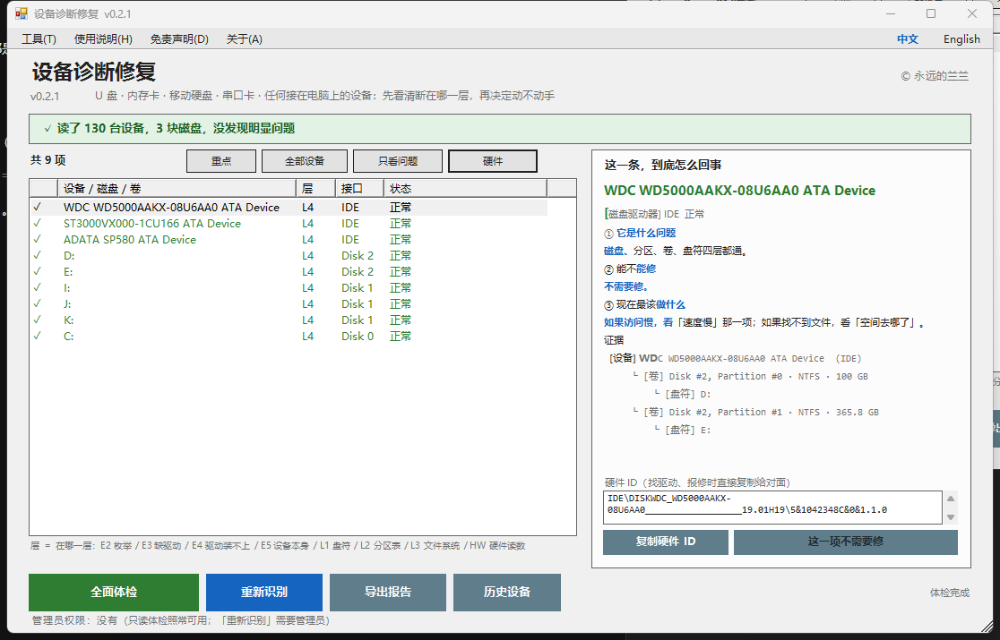
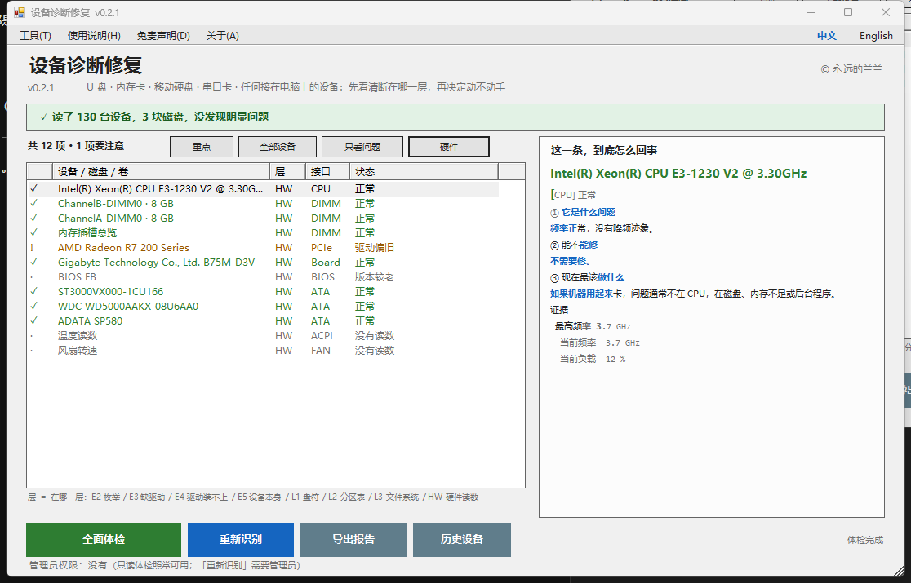

# 设备诊断修复 · DeviceLens

> U 盘、内存卡、移动硬盘、串口卡 —— 任何接在电脑上的设备。
> **先看清它断在哪一层，再决定动不动手。**

作者：**© 永远的兰兰**　·　版本：**v0.2.1**　·　Windows 7 / 10 / 11，32 位与 64 位通用
便携免安装 · 不联网 · 体检全程**只读**，修复只有两种、且都可撤销





---

## 它解决什么问题

一个设备不工作，原因一定落在某条链的某一环上：

```
物理接口 → 系统枚举 → 匹配驱动 → 驱动加载 → 设备功能
                                    ↓
                      磁盘 → 分区 → 卷 → 盘符
```

**第一个断掉的环节，决定了你该做什么，也决定了你不该做什么。**

绝大多数「我的盘坏了」，断的是中间那几环，不是设备真坏了：

| 你以为 | 实际常常是 | 结果 |
|---|---|---|
| 盘坏了 | 分区好好的，只是没分配盘符 | 一条命令就能用 |
| 硬盘报废了 | 系统完全认出了硬件，只是没有匹配的驱动 | 装对驱动就好 |
| U 盘烧了 | 设备被禁用了 | 一秒钟点回来 |
| 主板坏了 | 枚举卡住，Windows 没重新扫描 | 按一下「扫描硬件改动」 |

这几种，软件层零风险就能解决。
真正坏了的（磁头、颗粒磨穿、主控掉固件），再怎么重装驱动也没用 ——
那时候该做的是**别的决定**，而不是继续试。

**本工具要抢的，就是「送修、送数据恢复之前」那一段。**

---

## 核心：按「层」判定，不按功能罗列

这是它和其他工具最不一样的地方。每一行结论都带一个层号：

| 层 | 含义 | 软件能做什么 |
|---|---|---|
| **E2** | 枚举 —— Windows 完全看不到这台设备 | 重新扫描，多数能救 |
| **E3** | 匹配 —— 设备看到了，但没有匹配的驱动（代码 28） | 装对驱动就好，硬件是好的 |
| **E4** | 加载 —— 驱动装上了但启动不了（10 / 12 / 31 / 52） | 换驱动版本，通常能解 |
| **E5** | 功能 —— 驱动正常，那就该怀疑设备本身了 | 软件到头了，去看线/口/供电 |
| **L1** | 卷 —— 分区是好的，只是没有盘符 | 分配盘符，不动数据 |
| **L2** | 分区表 —— 没有分区，系统让你「初始化磁盘」 | **先别初始化**，先备份 |
| **L3** | 文件系统 —— 分区在，但读不出来（RAW） | 备份后重建，绝不代你格式化 |
| **L4** | 正常 | — |
| **HW** | 硬件读数 —— CPU / 内存 / 显卡 / 主板 / 温度 | 只读，给出结论与建议 |

为什么这个模型有用：**它把「能不能修」变成了可以从证据推出来的结论**，而不是靠猜。

断在 E2、L1 —— 零风险可修。
断在 E3、E4 —— 装对驱动，硬件完好。
断在 E5 —— 该停手了。

---

## 每一行都给三段式结论

点左边任何一条，右边只回答三个问题：

1. **它是什么问题**（一句人话 + 证据）
2. **能不能修**（能修 / 只能缓解 / 修不了，以及为什么）
3. **现在最该做什么**（先备份、立刻停手、还是直接换）

不给一堆术语让你自己翻译，也不给一个「一键修复」的赌局让你猜。
只有**真能修**的那两项才亮绿灯，点下去之前先把原样记下来。

---

## 它真的会动手修 —— 但只动两种

选中左边任意一行，右下角那个按钮会跟着变：

| 按钮 | 含义 |
|---|---|
| 🟢 **修复这一项（可还原）** | 这一项软件能修，点它 |
| ⚪ 这一项不需要修 | 本来就是正常的 |
| ⚪ 这一项软件修不了 | 得用别的办法，右边写清该找谁 |

只有两种情况会变绿：

1. **数据分区丢了盘符（L1）** —— 分配一个空闲盘符，不动盘里任何数据
2. **设备被禁用** —— 等同于设备管理器里点「启用设备」

点下去之后：

- 先弹确认框，写清「要做什么、对谁做」，你点「是」才动
- 不是管理员，先问你要不要以管理员身份重开
- **动手之前**把「改之前是什么样」写进留底文件
- 做完自动重新体检一遍，让你直接看到结果对不对

**反悔随时可以**：菜单「工具 → 撤销上一次修复」原样还原；
每次动作都记在「打开修复记录」里，留底在 `%APPDATA%\DeviceLens\fix\log.txt`。

灰色按钮不是「懒得修」，是这件事不该由软件替你决定：
格式化、重建分区表、恢复数据、刷固件、装下载站的驱动。

---

## 功能（v0.2.1）

- **修复（新）**：只做两种、都可撤销 —— 给丢了盘符的数据分区**分配盘符**、
  把被禁用的设备**重新启用**。动手前先写留底文件，菜单「撤销上一次修复」随时还原
- **只读体检**：设备 / 磁盘 / 卷 / 盘符**四层关联**，一眼看出断在哪
- **四视图清单**：重点 / 全部设备 / 只看问题 / **硬件**
- **硬件读数**：CPU 频率·核心·负载、内存条与插槽、显卡驱动版本与出厂日期、
  主板与 BIOS、硬盘健康状态、温度区、风扇转速 —— 并指出具体问题：
  CPU 被降频、内存没跑满频（XMP 未开）、显卡驱动多少年没更新、BIOS 多旧
- **分区身份判定**：EFI 启动分区 / MSR 保留分区 / 扩展分区容器**本来就不该有盘符**，
  不会误报成「分区无盘符」
- **22 个设备错误码翻译成人话**：代码 10 不是「坏了」，代码 28 不是「驱动丢了」，代码 52 先看系统时间
- **盘符占用看板 A–Z**：一眼看出「为什么 D 盘用不了」，不用翻磁盘管理
- **历史设备清单**：以前插过、现在没插的设备记录（学自 USBDeview）
- **重新识别（L0）**：等同于设备管理器的「扫描检测硬件改动」，零写入
- **导出诊断报告**：六段式（含硬件读数），可直接发给别人求助
- **中英双语**：菜单栏右上角一键切换，选择会被记住
- **便携**：解压即用，不装服务、不写系统、不联网、无遥测

### 快捷键

`F5` 全面体检　·　`F9` 重新识别

---

## 快速上手

1. 下载 [Releases](../../releases/latest) 里的 `device-lens.zip`
2. **整个解压**到硬盘上任意文件夹（不要在压缩包里直接双击）
3. 双击 `请双击这个-设备诊断修复.bat`
4. 把出问题的设备插上 → 点绿色「全面体检」→ 点左边任意一行

不需要管理员权限。只有「重新识别」需要，届时界面会提示，并可一键提权重开。

---

## 与同类工具的区别

不是要取代它们，是填一个它们都没填的位置：**中文、免费、说人话、可还原的「判因」环节**。

| 工具 | 强在 | 缺什么 | 本作的做法 |
|---|---|---|---|
| **USBDLM** | 盘符按序列号/端口全自动绑定，工业级 | 没有界面，只能手写 INI；全英文；必须装服务；商用要授权 | 图形界面 + 中文 + 便携免安装 + 开源；v0.2 起提供盘符绑定 |
| **USB Device Tree Viewer** | USB 拓扑树、协商速率、供电、描述符 | 只给数据，不给结论；纯英文 | 沿用「按控制器分组」的思路，但每个节点直接给一句人话结论 |
| **USBDeview** | 历史设备清单、时间戳、启停设备 | 扁平列表，无归因；纯英文 | 历史设备单独一页，且说明「它不影响使用」 |
| **CrystalDiskInfo** | SMART 读数，健康徽章 | 只对能读 SMART 的设备有效；不解释「该怎么办」 | 承认读不到 SMART 就不编；改用行为判据并说清依据 |
| **ValiDrive** | 576 点抽样验假容量 | 只有四种状态，没解释 | v0.4 起提供抽样 + 块图 + 中文解释 |

**本作独有**：按层判定 + 四层关联视图 + 三段式结论。这三件事目前没有中文工具在做。

---

## 它永远不会做的事

- 格式化磁盘
- 新建或删除分区 / 初始化磁盘
- 恢复数据
- 刷固件、用量产工具「修」U 盘
- 安装从下载站抓来的驱动

前四件，是把「小毛病」变成「全没了」的四条路。
最后一件，是把小毛病变成蓝屏的最快方式。

这些不是做不到，是**不该由「一键修复」来做**。

---

## 两个必须说清的事实

**一、很多设备读不到 SMART。**
U 盘、内存卡、廉价硬盘盒，绝大多数读不到健康数据 —— 不是工具不行，
是 USB 桥接芯片不透传 ATA 命令。

所以本工具**不会给你编一个「健康度 87%」**。能给的结论都基于实际读到的证据：
错误码、分区链是否完整、文件系统能不能读、盘符对不对得上。
读不到就说读不到。

**二、判断是意见，不是判决。**
「这台设备疑似故障」是概率，不是结论。专业人员上手检查的结果永远优先于本工具。

---

## 姊妹工具

**[USB / 串口 一键修复](https://github.com/podcatcher962/usb-com-fix)** —— 管两件事：
把串口设备的 COM 端口号固定住；让 Windows 死活认不出的 USB 设备重新被识别。

本作管的是：任何设备先看清断在哪一层。COM 端口号的事请用前作，
本工具只在结论里提示，不重复实现（功能边界比代码隔离更重要）。

**两款是彼此独立的程序，必须放在各自的文件夹里** —— 混装会互相覆盖。
本程序启动时会检查这一点，发现同目录有前作文件会直接拒绝运行。

---

## 版本

| 版本 | 内容 |
|---|---|
| **v0.2.1** | 新增修复：分配盘符 / 启用设备，均可撤销 · 撤销与修复记录菜单 · 修掉英文界面里最后两处中文残留 · 修正确认框漏出的 `{n}` 占位符 |
| **v0.1.0** | 只读体检 + 四层关联 + 按层判定 + 22 个错误码 + 盘符看板 + 历史设备 + 重新识别 + 报告导出 + 中英双语 |

**后续计划**（按这个顺序，每一步都可还原）：

- **v0.3** 钉盘符 / 守护 · 失效播放列表路径修复 · 挂载到文件夹
- **v0.4** 假容量抽样 + 块图 · 设备身份证 · 分区表首尾镜像备份
- **v0.5** 救设备模式（L2 重建分区表 / L3 chkdsk / L4 写零）· 四类「修不了」判定
- **v0.6** 拒绝访问修复（备份 ACL 后 takeown/icacls）· 写保护五种原因 · 空间去向 · 插错口检测

---

## 开发

```
_src/dl-core.ps1    核心：枚举 / 判定 / 报告（界面与命令行共用）
_src/dl-gui.ps1     界面：WinForms，1100×676，中英双语
build.py            打包：.ps1 → UTF-8 BOM + CRLF，.bat → GBK + CRLF
```

```bash
python build.py
```

打包规则不能省：PowerShell 5.1 读 `.ps1` 要求 **UTF-8 带 BOM**，
cmd 读 `.bat` 要求 **GBK**。用编辑器另存很容易漏，一漏就是「双击没反应」。

界面自测：

```powershell
.\dl-gui.ps1 -AutoScan -Shot shot.png -Lang zh
.\dl-gui.ps1 -AutoScan -ShotFix -Shot fix.png -Lang en   # 验证修复按钮
```

---

## 许可

MIT。详见 [LICENSE](LICENSE)。

本程序按「现状」提供，不附带任何担保。涉及重要数据时，先做数据恢复，再谈修盘。

---

**© 永远的兰兰** · Lanlan Eternal
